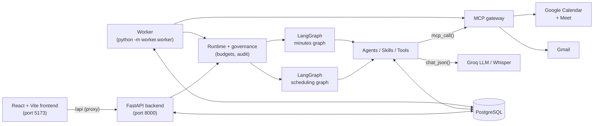
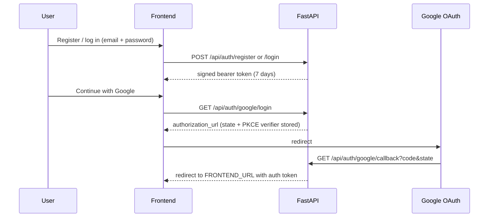
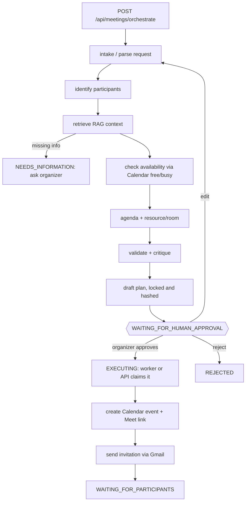
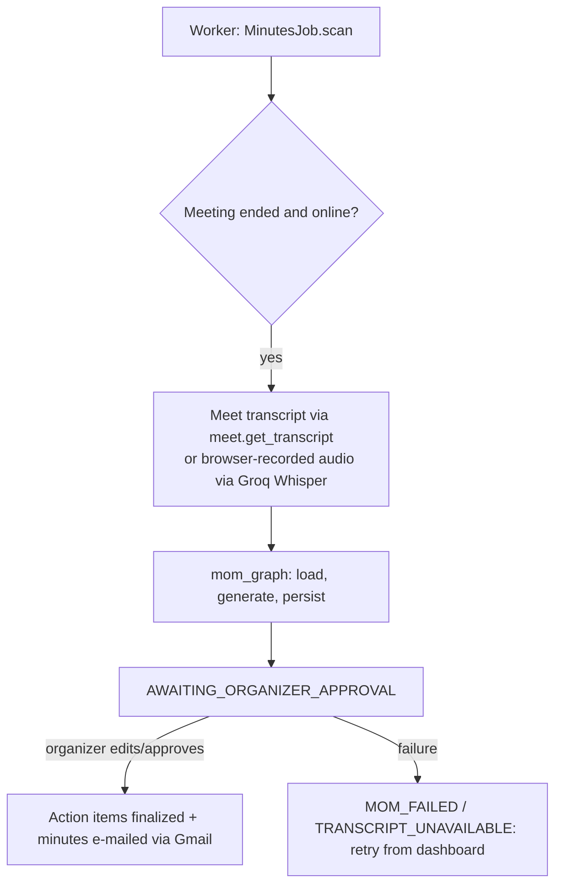
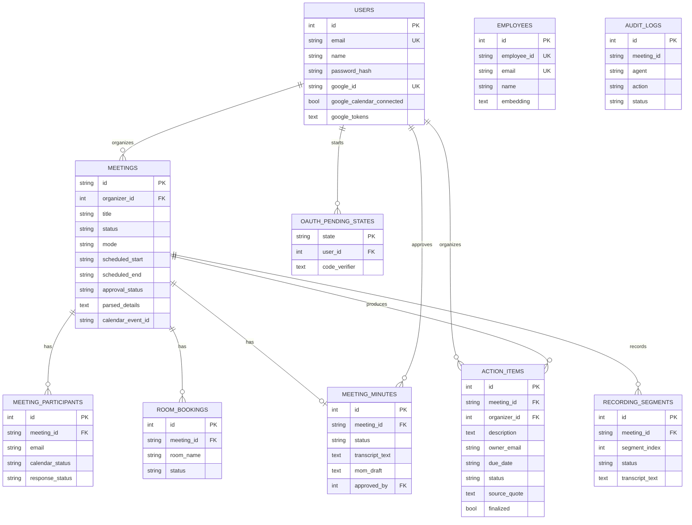

# Meeting Organizer Agent

An AI-assisted meeting organizer. An organizer describes a meeting in plain language; a LangGraph workflow of cooperating agents parses the request, checks availability through Google Calendar, drafts an agenda, proposes a plan, and **waits for the organizer's approval** before anything is created or sent. After the meeting, the system drafts **Minutes of Meeting (MoM)** and **action items** from a transcript, and again waits for the organizer to approve them before they are emailed.

> **Status:** a working development/prototype build. It has not been hardened for production (see [Known limitations](#known-limitations)).

---

## Table of Contents

1. [Overview](#1-overview)
2. [Key Features](#2-key-features)
3. [Technology Stack](#3-technology-stack)
4. [System Architecture](#4-system-architecture)
5. [Project Structure](#5-project-structure)
6. [Prerequisites](#6-prerequisites)
7. [Installation and Setup](#7-installation-and-setup)
8. [Environment Variables](#8-environment-variables)
9. [Google Cloud and OAuth Configuration](#9-google-cloud-and-oauth-configuration)
10. [API Reference](#10-api-reference)
11. [Database Design](#11-database-design)
12. [AI Agent Workflow](#12-ai-agent-workflow)
13. [Running the Application](#13-running-the-application)
14. [Testing](#14-testing)
15. [Known Limitations](#known-limitations)

---

## 1. Overview

**Problem.** Organizing a meeting involves many manual steps: finding a free slot, writing an agenda, sending invitations, chasing replies, and afterwards writing minutes and following up on tasks.

**Objectives.**

- Turn a natural-language request ("Schedule a project review with a@x.com and b@y.com tomorrow at 10 AM") into a structured, reviewable meeting plan.
- Keep a human in control: no calendar event, invitation, venue request or minutes email is produced without explicit organizer approval.
- Produce minutes and action items that are grounded in a real transcript, and never invent discussion content.

---

## 2. Key Features

### Implemented

| Area | Feature |
| --- | --- |
| Accounts | Email + password registration and login (PBKDF2-hashed passwords, signed bearer tokens valid 7 days). |
| Accounts | "Continue with Google" sign-in and a separate "Connect Google Calendar/Gmail" flow, both OAuth 2.0 with PKCE. |
| Scheduling | Natural-language request → structured meeting (LLM extraction via Groq, with a rule-based fallback when no API key is set). |
| Scheduling | Participants are names + emails; names without an email stop the workflow with a question (`NEEDS_INFORMATION`). Participants do not need an account. |
| Availability | Google Calendar free/busy for the organizer and for participants who have connected their own Google account. Everyone else is shown as "Availability not verified" (never treated as free or blocking, still invited). |
| Agenda | Agenda generation/refinement (LLM with rule-based fallback), editable by the organizer; open action items of the organizer can be suggested for a new agenda. |
| Rooms / venue | Online meetings get a Google Meet link. In-person meetings use a room catalog and a **venue request e-mailed through Gmail**; the coordinator's reply is read back from Gmail. |
| Approval | Human approval gate (approve / edit / reject). Execution only starts from a persisted approval. |
| Invitations | On approval: Google Calendar event is created and an invitation is sent through the Gmail API. |
| RSVP tracking | The worker polls the Google Calendar event and records each attendee's response (`ACCEPTED` / `REJECTED`) on the dashboard. See the note below. |
| Dashboard | Meeting list with status, participants and responses, approval modal, details modal, audit trail data. |
| Minutes (MoM) | For online (Google Meet) meetings: transcript retrieval from the Meet API, or browser-recorded audio transcribed by Groq Whisper; LLM draft limited to evidence-quoted decisions and action items; organizer reviews/edits/approves; minutes e-mailed after approval. |
| Action items | Extracted from the minutes, finalized on approval, tracked on an Action Items page; the assignee may change only the task status. |
| Governance | Per-run step / LLM-call / time budgets, audit events for every node and action, crash recovery of stuck executions. |

> **About RSVP.** RSVP status is read from the **Google Calendar attendee response** (`accepted` / `declined`), not from parsing reply e-mails. A "Maybe" (`tentative`) answer is **not** mapped: such participants stay `PENDING`. Gmail replies are parsed only for the venue coordinator's confirmation of an in-person venue. RSVP syncing is skipped when `DEMO_MODE=true`.

---

## 3. Technology Stack

| Layer | Technology | Where / how it is used |
| --- | --- | --- |
| Language | Python | Backend, worker, tests. The local `.venv` was created with Python 3.14.5; the repo does not pin a version. |
| Language | JavaScript (JSX) | Frontend. |
| Backend framework | FastAPI, Uvicorn | REST API (`backend/app/main.py`, `routes_minutes.py`). |
| Validation / settings | Pydantic v2, pydantic-settings | Request schemas, typed tools, `.env` settings (`backend/app/config.py`). |
| Database | PostgreSQL (psycopg 3) | Default `DATABASE_URL`. SQLite is used by the test suite. |
| ORM / migrations | SQLAlchemy 2, Alembic | Models in `backend/app/db.py`; migrations in `alembic/versions/`. `create_all()` also runs at import. |
| Agent orchestration | LangGraph | Scheduling graph (`backend/graph/workflow_graph.py`) and minutes graph (`backend/graph/mom_graph.py`). |
| LLM / speech | Groq API (`groq` SDK, OpenAI-compatible endpoint) | Request extraction, agenda refinement, MoM generation (default model `openai/gpt-oss-120b`); Whisper (`whisper-large-v3`) for recordings. |
| Google APIs | Calendar API, Gmail API, Meet REST API v2 | Free/busy, events + Meet links, RSVP reads, invitation and minutes e-mail, venue requests, transcripts. Via `google-api-python-client`. |
| Authentication | PBKDF2 passwords, signed bearer tokens, Google OAuth 2.0 + PKCE | `backend/app/auth.py`, `backend/connectors/google_auth.py`; `itsdangerous` signs OAuth state. |
| Connector layer | MCP-style gateway (JSON-RPC style capabilities) | `backend/connectors/mcp_gateway.py`; all external side effects go through it. Mock adapters when `DEMO_MODE=true`. |
| Retrieval | NumPy | Local hashing-embedding similarity (`backend/memory/long_term_memory.py`). |
| Frontend | React 19, Vite, Tailwind CSS 4, lucide-react | UI, dev server with `/api` proxy. |
| Frontend tooling | oxlint, Node built-in test runner | `npm run lint`; recorder tests. |
| Misc | httpx, tzdata, python-multipart | HTTP client, time zones, audio upload parsing. |
| Testing | pytest | `tests/`. |

---

## 4. System Architecture

The browser talks only to the FastAPI backend. The backend runs LangGraph workflows whose nodes call agents; agents call skills and typed tools; tools reach Google only through the MCP gateway. A separate **worker** process polls the database and Google for work that has to happen after approval or after the meeting.



### Workflows

**1. Authentication**



Connecting Google Calendar/Gmail (`GET /api/auth/google/connect`) uses the same callback with the wider scopes; the resulting tokens are stored on the user record.

**2. Meeting creation and invitation**



**3. RSVP processing.** Every 5 seconds the worker reads the Google Calendar event of meetings in `WAITING_FOR_PARTICIPANTS`, maps attendee `accepted`/`declined` to `ACCEPTED`/`REJECTED`, and resumes the workflow (process responses → revalidate → finalize). When all participants have accepted (and, for in-person meetings, the venue is confirmed) the meeting becomes `CONFIRMED`. The UI also has a manual "check for responses" action and a clearly labelled simulator for testing.

**4. Minutes of Meeting**



**5. Action items.** The MoM agent proposes action items with a source quote from the transcript. They stay hidden drafts until the organizer approves the minutes. After that, each assignee (matched by e-mail) sees them under "mine"; the organizer sees all items of their meetings under "organized". Assignees may change only the status (`NOT_STARTED`, `IN_PROGRESS`, `COMPLETED`).

---

## 5. Project Structure

```text
.
├── backend/
│   ├── app/            # FastAPI app: main.py, routes_minutes.py, auth.py, config.py, db.py (models),
│   │                   #   action_items.py, recordings.py
│   ├── agents/         # Coordinator, Participant, Scheduling, Agenda, Resource, Validation, MoM, Venue coordinator
│   ├── graph/          # workflow_graph.py (scheduling), mom_graph.py (minutes), state.py
│   ├── skills/         # Scheduling, agenda, plan (locked/versioned), format, validation, minutes skills
│   ├── tools/          # Typed tools (calendar, participants, rooms, email, state)
│   ├── connectors/     # mcp_gateway, google_auth, calendar/email/room/meet services, groq_client, transcription
│   ├── memory/         # session, long-term (RAG) and audit memory
│   ├── runtime/        # runtime loop, agent interface, governance (budgets)
│   └── requirements.txt
├── worker/             # Background worker: worker.py, jobs/ (meeting, response, minutes, ...), state/
├── frontend/           # React + Vite app
│   └── src/            # App.jsx, components/, pages/ (MeetingDashboard, Auth, ActionItems), services/
├── alembic/            # Migrations (versions/)
├── database/           # seed/ (room catalog), migrate_sqlite_to_postgres.py, schema/ (stale)
├── docs/               # architecture.md, worklet.md
├── tests/              # unit/, integration/, workflow/ and feature tests
├── alembic.ini
├── .env.example
└── CLAUDE.md           # Working guide for AI-assisted coding sessions
```

Not maintained: `docker-compose.yml`, `backend/Dockerfile`, `frontend/Dockerfile`, `worker/Dockerfile`, `database/schema/schema.sql`. `frontend/src/pages/EmployeeDashboard/` and `UnknownParticipantModal.jsx` are legacy code that the current UI does not mount.

---

## 6. Prerequisites

- **Python 3** with `pip` (the repo does not pin a version; the author's venv uses 3.14.5).
- **Node.js and npm** (version not pinned; the frontend uses Vite 8 and React 19, so use a current LTS release).
- **PostgreSQL** reachable at the `DATABASE_URL` you configure (the default driver is `psycopg` 3).
- A **Google Cloud** account with a project in which you can create an OAuth client.
- Google APIs: **Google Calendar API** and **Gmail API**. Transcript retrieval additionally needs the **Google Meet REST API** and the `meetings.space.readonly` scope.
- A **Groq API key** (optional): without it, extraction and agenda use the rule-based fallback, and minutes/transcription report an error.

---

## 7. Installation and Setup

Commands are for Windows PowerShell; on macOS/Linux use `source .venv/bin/activate` and `cp`.

```powershell
# 1-2. Clone and enter the project
git clone <your-repository-url>
cd <repository-folder>

# 3. Python virtual environment
python -m venv .venv
.venv\Scripts\Activate.ps1

# 4. Backend dependencies
pip install -r backend/requirements.txt

# 5. Frontend dependencies
cd frontend
npm install
cd ..
```

**6. Database.** Create an empty PostgreSQL database (for example `meeting_organizer`) and put its URL in `.env` as `DATABASE_URL`. Tables are created automatically when the backend starts (`Base.metadata.create_all`). The repository also ships Alembic migrations; to apply them to an empty database, run `alembic upgrade head` from the repo root (`alembic/env.py` reads `DATABASE_URL`).

**7-9. Google Cloud and environment.** Follow [section 9](#9-google-cloud-and-oauth-configuration), then:

```powershell
Copy-Item .env.example .env
# edit .env: DATABASE_URL, SECRET_KEY, GOOGLE_*, GROQ_API_KEY
python -c "import secrets; print(secrets.token_hex(32))"   # use the output as SECRET_KEY
```

**10-12.** Start the backend, worker and frontend as shown in [Running the Application](#13-running-the-application), then open <http://localhost:5173>.

---

## 8. Environment Variables

Copy `.env.example` to `.env` (project root, the directory from which `uvicorn` is started). Never commit `.env`; it is listed in `.gitignore`.

| Variable | Purpose | Example / format |
| --- | --- | --- |
| `DATABASE_URL` | Database connection | `postgresql+psycopg://<user>:<password>@localhost:5432/meeting_organizer` |
| `SECRET_KEY` | Signs OAuth state and (required for OAuth) | long random string |
| `GOOGLE_CLIENT_ID` | OAuth client ID | `<id>.apps.googleusercontent.com` |
| `GOOGLE_CLIENT_SECRET` | OAuth client secret | `<secret>` |
| `GOOGLE_REDIRECT_URI` | OAuth callback; must match the Google console exactly | `http://localhost:8000/api/auth/google/callback` |
| `GOOGLE_CLOUD_PROJECT_ID` | Google Cloud project id | `my-project-123` |
| `GOOGLE_OAUTH_SCOPES` | Space- or comma-separated scopes (defaults in `config.py`) | see section 9 |
| `GOOGLE_OAUTH_STATE_TTL_SECONDS` | Validity of an OAuth state (single use) | `600` |
| `GOOGLE_HOSTED_DOMAIN` | Optional: restrict sign-in to a Workspace domain | `yourcompany.com` |
| `GOOGLE_CALENDAR_OWNER_EMAIL` | Optional: connected account that organizes events/sends mail | `organizer@example.com` |
| `GOOGLE_AUTH_URI`, `GOOGLE_TOKEN_URI` | Optional endpoint overrides | Google defaults |
| `GROQ_API_KEY` | Groq key for LLM and Whisper | `gsk_...` |
| `AI_PROVIDER` | Provider name | `groq` |
| `GROQ_BASE_URL` | Groq endpoint | `https://api.groq.com/openai/v1` |
| `GROQ_LLM_MODEL` | Model for extraction, agenda, minutes | `openai/gpt-oss-120b` |
| `GROQ_TRANSCRIPTION_MODEL` | Speech-to-text model | `whisper-large-v3` |
| `DEMO_MODE` | `true` swaps Google adapters for offline mocks (tests/offline dev) | `false` |
| `MEETING_TIMEZONE` | Time zone used to interpret typed times; stored times are UTC | `UTC` or an IANA zone |
| `FRONTEND_URL` | Where OAuth returns the browser | `http://localhost:5173` |
| `CORS_ORIGINS` | Allowed browser origins | `http://localhost:5173,http://127.0.0.1:5173` |
| `BACKEND_HOST`, `BACKEND_PORT` | Server bind settings | `0.0.0.0`, `8000` |
| `MINUTES_MAX_WAIT_HOURS` | How long to keep retrying for a Meet transcript | `48` |
| `MEET_EVENTS_TOKEN` | Optional shared secret for the Pub/Sub push endpoint `/api/meet/events` | random string |
| `RECORDINGS_DIR` | Folder for browser-recorded audio (API and worker must share it) | `data/recordings` |
| `RECORDING_RETENTION_DAYS` | Days to keep raw audio after transcription (0 = delete at once) | `7` |
| `RECORDING_MAX_SEGMENT_MB` | Max upload size per audio segment | `24` |
| `TRANSCRIPTION_MAX_ATTEMPTS` | Transcription retries | `5` |
| `RUNTIME_MAX_STEPS`, `RUNTIME_MAX_LLM_CALLS`, `RUNTIME_MAX_SECONDS` | Per-run budgets | `50`, `20`, `300` |
| `EXECUTION_STUCK_MINUTES` | Minutes before the worker resumes a stuck execution | `10` |
| `ROOM_CATALOG_FILE` | Optional JSON file with rooms (`name`, `capacity`, `equipment`, `location`, `requires_approval`) | `./rooms.json` |

---

## 9. Google Cloud and OAuth Configuration

1. Open the [Google Cloud Console](https://console.cloud.google.com/) and **create a project** (or select one).
2. **APIs & Services → Library**: enable **Google Calendar API**, **Gmail API** and, for transcripts, **Google Meet REST API**.
3. **OAuth consent screen**: choose a user type, fill in the app details, and add the scopes below. While the app is in **Testing**, add every Google account that will sign in or be connected as a **test user**.
4. **Credentials → Create credentials → OAuth client ID → Web application**. Add the authorized redirect URI:
   `http://localhost:8000/api/auth/google/callback` (must equal `GOOGLE_REDIRECT_URI`).
5. Copy the client ID and secret into `.env` as `GOOGLE_CLIENT_ID` / `GOOGLE_CLIENT_SECRET`.

**Scopes.** Sign-in ("Continue with Google") requests `openid`, `userinfo.email`, `userinfo.profile`. Connecting an account requests the defaults from `backend/app/config.py`:

```text
openid
https://www.googleapis.com/auth/userinfo.email
https://www.googleapis.com/auth/calendar
https://www.googleapis.com/auth/gmail.send
https://www.googleapis.com/auth/gmail.readonly
https://www.googleapis.com/auth/meetings.space.readonly
```

Accounts connected before `meetings.space.readonly` was added must reconnect.

**Restrictions.**

- `calendar`, `gmail.send`, `gmail.readonly` and `meetings.space.readonly` are sensitive/restricted scopes. Using them for users outside your test list requires Google's OAuth app verification (and, for restricted Gmail scopes, a security assessment). In Testing mode, Google limits the number of test users and expires refresh tokens after a short period.
- Google Meet transcripts are only produced for accounts/plans where Meet transcription is available (typically Google Workspace). For other accounts the app offers browser-recorded audio transcribed by Groq instead.
- Nothing in this repository claims or demonstrates production readiness; see [Known limitations](#known-limitations).

---

## 10. API Reference

All paths are prefixed `/api`. "Auth: Required" means `Depends(get_current_user)` (a bearer token in the `Authorization` header). "Optional" means the endpoint accepts but does not require a token. "None" means the route as implemented performs no authentication. Several routes marked None/Optional are flagged as known gaps below.

### System

| Method | Endpoint | Purpose | Auth |
| --- | --- | --- | --- |
| GET | `/health` | Health check | None |
| GET | `/system-info` | Mode and AI configuration status | None |

### Authentication

| Method | Endpoint | Purpose | Auth |
| --- | --- | --- | --- |
| POST | `/auth/register` | Register with email/password | None |
| POST | `/auth/login` | Log in, returns token | None |
| GET | `/auth/me` | Current user profile | Required |
| GET | `/auth/google/login` | Start "Continue with Google" | None |
| GET | `/auth/google/connect` | Start Calendar/Gmail connection | Required |
| POST | `/auth/google/disconnect` | Remove stored Google tokens | Required |
| GET | `/auth/google/callback` | OAuth callback (state + PKCE validated) | None (signed state) |

### Meetings

| Method | Endpoint | Purpose | Auth |
| --- | --- | --- | --- |
| POST | `/meetings/orchestrate` | Create a meeting from a natural-language request | Optional |
| GET | `/meetings` | List organized/participating meetings | Optional |
| GET | `/meetings/{id}` | Meeting details | Optional |
| DELETE | `/meetings/{id}` | Soft-delete a meeting | Optional |
| POST | `/meetings/{id}/approval` | Approve / edit / reject the draft plan | Optional |
| POST | `/meetings/{id}/clarify` | Answer the workflow's questions | None |
| POST | `/meetings/{id}/agenda` | Set/replace the agenda before approval | None |
| POST | `/meetings/{id}/venue-request` | Send venue request e-mail (in-person) | Optional |
| POST | `/meetings/{id}/attendance` | Record attendance | Required |
| POST | `/meetings/sync-responses` | Sync RSVPs/venue replies for all meetings | None |
| POST | `/meetings/{id}/sync-responses` | Sync RSVPs/venue replies for one meeting | None |
| POST | `/meetings/{id}/simulate-participant` | Simulated response (testing) | None |
| POST | `/meetings/{id}/simulate-room` | Simulated venue response (testing) | None |

### Minutes, recordings and action items (`routes_minutes.py`; ownership checked)

| Method | Endpoint | Purpose | Auth |
| --- | --- | --- | --- |
| GET | `/meetings/{id}/minutes` | Minutes status and draft | Required |
| POST | `/meetings/{id}/minutes/check-transcript` | Fetch the transcript now | Required |
| POST | `/meetings/{id}/minutes/regenerate` | Regenerate the draft | Required |
| PUT | `/meetings/{id}/minutes` | Edit the draft | Required |
| POST | `/meetings/{id}/minutes/approve` | Approve; finalize action items and e-mail minutes | Required |
| GET | `/action-items` | List items (`scope=mine` or `organized`) | Required |
| PATCH | `/action-items/{item_id}` | Update an item | Required |
| GET | `/meetings/{id}/followup-suggestions` | Suggest open tasks for a new agenda | Required |
| PUT | `/meetings/{id}/followups` | Select follow-up tasks | Required |
| POST | `/meetings/{id}/recording/start` | Start a browser recording | Required |
| POST | `/meetings/{id}/recording/segments` | Upload an audio segment | Required |
| POST | `/meetings/{id}/recording/finish` | Finish the recording | Required |
| POST | `/meetings/{id}/recording/retry` | Retry transcription | Required |
| POST | `/meetings/{id}/recording/discard` | Discard the recording | Required |
| DELETE | `/meetings/{id}/recording/audio` | Delete stored raw audio | Required |
| POST | `/meet/events?token=...` | Pub/Sub push from Google Workspace Events | Shared secret (`MEET_EVENTS_TOKEN`) |

### Employees (profile records, partly legacy)

| Method | Endpoint | Purpose | Auth |
| --- | --- | --- | --- |
| GET | `/employees`, `/employees/search`, `/employees/by-email/{email}` | List / search / read | None |
| POST | `/employees` | Create | None |
| PUT | `/employees/{id}`, `/employees/by-email/{email}` | Update | None |
| DELETE | `/employees/{id}` | Delete | None |
| POST | `/employees/{id}/toggle-calendar` | Toggle calendar flag | None |
| GET | `/employees/{id}/calendar/connect`, `/employees/by-email/{email}/calendar/connect` | Start Google connection | None |
| GET | `/employees/{id}/calendar/status`, `/employees/by-email/{email}/calendar/status` | Connection status | None |
| DELETE | `/employees/{id}/calendar`, `/employees/by-email/{email}/calendar` | Disconnect | None |

### Audit, MCP and legacy

| Method | Endpoint | Purpose | Auth |
| --- | --- | --- | --- |
| GET | `/audit-logs`, `/audit-logs/{meeting_id}` | Audit trail | None |
| GET | `/mcp/capabilities` | List MCP capabilities | Required |
| POST | `/mcp` | Execute an MCP capability (caller-scoped; consequential calls need an approved, owned meeting) | Required |
| POST | `/meetings/{id}/resolve-participant`, `/recheck-participant`, `/remove-participant` | Legacy participant-directory flow, not used by the current UI | None |

---

## 11. Database Design

PostgreSQL is the default (`DATABASE_URL`, psycopg 3). SQLAlchemy 2 declarative models live in `backend/app/db.py`; `create_all()` runs at import and Alembic migrations (`alembic/versions/`) describe the schema. The test suite uses a separate SQLite file. Timestamps in meeting rows are stored as UTC ISO strings ending in `Z`.



- **Meetings.** One row per meeting; the resumable workflow snapshot, locked plan and execution checkpoints are stored as JSON in `meetings.parsed_details`.
- **Participants and RSVP.** `meeting_participants` stores `calendar_status` (`AVAILABLE`, `BUSY`, `UNVERIFIED`) and `response_status` (`PENDING`, `ACCEPTED`, `REJECTED`). Participants are linked to a meeting by e-mail, not to a user account.
- **Minutes.** One `meeting_minutes` row per meeting holds the transcript, the JSON draft (`mom_draft`) and a status machine (`WAITING_FOR_TRANSCRIPT` … `APPROVED_AND_DISTRIBUTED`).
- **Action items.** `action_items` rows keep the evidence quote and stay `finalized = false` (hidden) until the minutes are approved.
- **Audit.** `audit_logs` records every agent/human action and each LangGraph node (state keys only, never values).
- `employees` is a separate profile table (with a stored hashing embedding) used for retrieval; it has no foreign key to the other tables.

---

## 12. AI Agent Workflow

**Providers.** All LLM calls go through `backend/connectors/groq_client.py` (JSON-object responses, bounded retries). Groq's chat model handles request extraction (`MeetingCoordinator`), agenda refinement (`AgendaAgent`) and minutes generation (`MoMAgent`); Groq Whisper transcribes recorded audio. If no key is configured, extraction and agenda fall back to deterministic rules.

**Agents** (each subclasses `BaseAgent` and returns an `AgentOutput`): Meeting Coordinator, Participant, Scheduling & Availability, Agenda, Resource/Room, Validation, MoM (minutes), Venue Coordinator. Agents use skills (`backend/skills/`) and typed tools (`backend/tools/`); tools call the MCP gateway for anything external.

**Scheduling graph** (`workflow_graph.py`): intake → parse → participants → RAG context → (ask for information → END) | availability → (alternative slot) → agenda → resource → validate/critique → draft plan → approval gate → END at `WAITING_FOR_HUMAN_APPROVAL`. Approval, edits and responses re-enter the **same persisted meeting** through `resume_meeting_workflow`; the graph has no checkpointer, and state is rebuilt from the database.

**Minutes graph** (`mom_graph.py`): load → generate → persist | fail.

**How minutes and action items are produced.**

1. The worker's `MinutesJob` finds ended online meetings and fetches the Google Meet transcript (`meet.get_transcript`), retrying with back-off until `MINUTES_MAX_WAIT_HOURS`. Alternatively the organizer records the meeting audio in the browser; segments are uploaded, transcribed by Whisper and merged into a transcript.
2. `MoMAgent` prompts the LLM with the transcript. The output is validated by `MinutesOfMeetingSkill`: decisions and action items are kept only when backed by a quote found in the transcript.
3. The draft is saved in `meeting_minutes.mom_draft` with status `AWAITING_ORGANIZER_APPROVAL`; action items are saved unfinalized.
4. The organizer reviews and edits in the Minutes panel and approves. Only then are action items finalized and the minutes e-mailed through Gmail.

**Governance.** Each run is limited by step, LLM-call and time budgets; every node and action is audited; approved-but-stuck executions are resumed by the worker. External delivery is at-least-once, not exactly-once (a crash between a Google call and its checkpoint can repeat that call).

---

## 13. Running the Application

Run each command from the repository root (the backend imports use absolute `backend.…` and `worker.…` paths). Use three terminals.

```powershell
# Terminal 1 - backend (API on http://localhost:8000)
.venv\Scripts\Activate.ps1
uvicorn backend.app.main:app --port 8000 --reload
```

```powershell
# Terminal 2 - frontend (http://localhost:5173, proxies /api to port 8000)
cd frontend
npm run dev
```

Open <http://localhost:5173>, register or continue with Google, connect your Google account, and create a meeting. The worker is required for executing approved meetings, syncing RSVPs and generating minutes.

---

## 14. Testing

```powershell
.venv\Scripts\python.exe -m pytest -q -p no:cacheprovider      # backend
cd frontend; npm run lint; npm run build                       # frontend
node --test src/services/meetingRecorder.test.js               # recorder (from frontend/)
```

Tests force `DEMO_MODE=true`, use a separate SQLite database and need no network, Google or Groq. At the last recorded baseline (2026-11-16) the suite had **234 tests: 188 passed, 46 failed**; most failures are stale expectations from a removed employee-directory flow, and the acceptance suite is not green.

---

## Known limitations

- Several endpoints are unauthenticated or optionally authenticated (see the API tables): `clarify`, `agenda`, `sync-responses`, `/audit-logs*`, `/employees*`, and the optional-auth meeting routes can be called without ownership checks. Do not expose this build to untrusted networks.
- `/auth/register` can set a password on an existing Google-only account without proving e-mail ownership; the OAuth callback does not check that the returned Google account matches the user.
- A Google Calendar event with a Meet link is created at the draft stage, before approval.
- "Maybe" RSVP answers are not recorded; RSVPs come from Google Calendar, not e-mail replies.
- `config.py` has a default `DATABASE_URL` containing a placeholder credential; always set your own.
- Docker files and `database/schema/schema.sql` are stale.
- No reminders, version history or rollback for agenda/minutes drafts.
